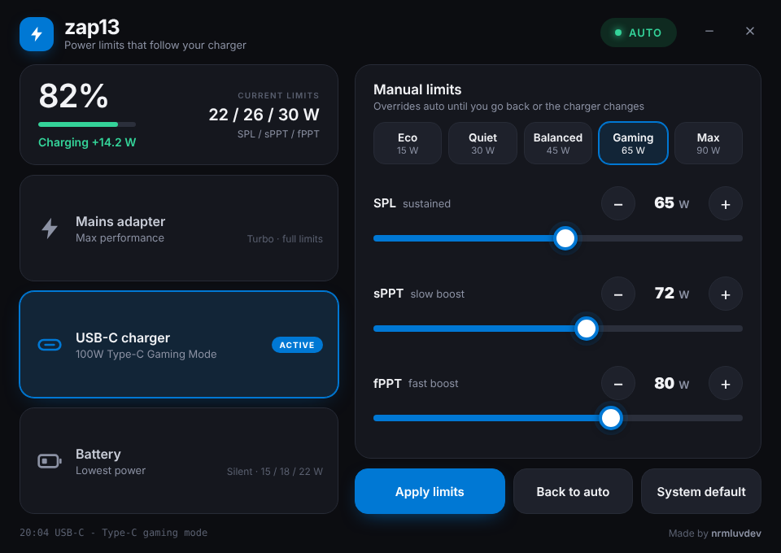

# zap13

Power limit control for the **ASUS ROG Flow Z13 (2025)**.

I wanted my Z13 to actually charge while gaming on a USB-C charger instead of slowly draining, so I made this. It works out what you're plugged into and sets the APU power limits to match. You can also set your own limits with the sliders.



## Features

- **Switches automatically based on the charger**
  - 200 W barrel adapter: full performance (firmware Turbo)
  - USB-C: Type-C Gaming Mode, which keeps the battery charging under load
  - Battery: lowest power
- **Manual sliders** for SPL / sPPT / fPPT, with big +/- buttons for the touchscreen
- **Presets**: Eco, Quiet, Balanced, Gaming and Max, plus a button to put the sliders back to default
- **Live status**: battery %, charge/drain rate in watts and the limits currently applied
- Follows your **Windows accent colour**
- Re-applies your limits every 30 s, because the firmware sometimes resets them
- Single portable .exe with no installer and no tray clutter

## Download

Grab `zap13.exe` from [Releases](https://github.com/normanlove/zap13/releases) and run it.

The exe isn't code signed, so SmartScreen will probably complain the first time. Click **More info → Run anyway**. If you'd rather not, building it yourself is easy (see below).

## Requirements

- ROG Flow Z13 2025 (GZ302) on Windows 11
- The **ASUS System Control Interface** driver. You already have it if MyASUS or Armoury Crate is installed. Otherwise it's on the ASUS support page for your model.
- WebView2 runtime (already part of Windows 11)

Close Armoury Crate and G-Helper while zap13 is running, otherwise they'll fight over the power limits.

## How it works

zap13 talks to the `\\.\ATKACPI` driver, the same interface Armoury Crate uses, to switch the performance mode and write the three AMD power limits:

| | |
|---|---|
| **SPL** | sustained limit |
| **sPPT** | slow boost (a few minutes) |
| **fPPT** | fast boost (a few seconds) |

It checks the power source every 5 seconds. Manual limits stay on until you hit **Back to auto** or plug/unplug a charger.

Settings are saved to `%APPDATA%\zap13\settings.json`.

## Building

You need Go 1.24+.

```
go build -ldflags "-H windowsgui -s -w" -o zap13.exe .
```

You can also cross-compile from Linux/macOS with `GOOS=windows GOARCH=amd64`.

The icon, manifest and version info are in `winres/`. After changing them, regenerate the `.syso` with [go-winres](https://github.com/tc-hib/go-winres):

```
go-winres make --in winres/winres.json --arch amd64
```

## Credits

- [G-Helper](https://github.com/seerge/g-helper), for documenting the ASUS ACPI device IDs
- [go-webview2](https://github.com/jchv/go-webview2)

## Disclaimer

This is an unofficial tool and isn't affiliated with ASUS. The firmware rejects values outside its own range and the chip still protects itself thermally, but you use it at your own risk.

## License

MIT
